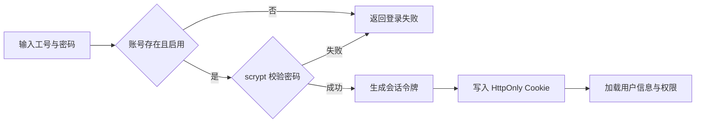
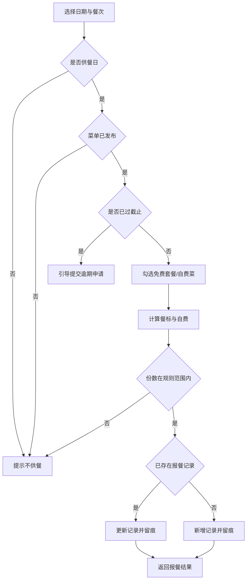
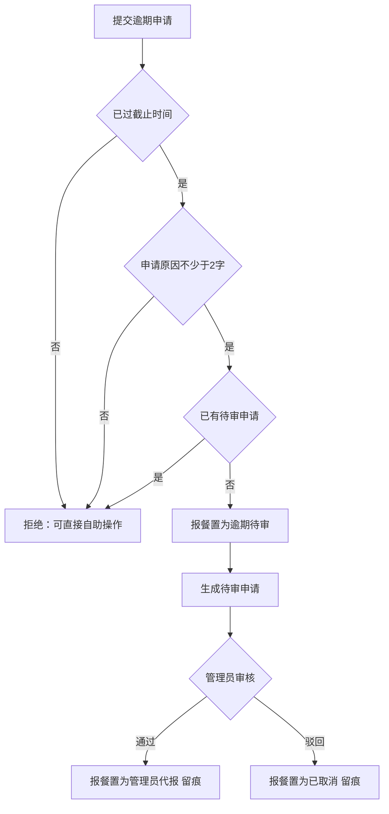

# 机关单位内部报餐系统 · 产品设计文档

> 适用范围：政府机关单位内部食堂，职工自助报餐、管理员统一管理。
> 系统形态：Web H5（职工端）+ Web 管理后台，服务端为零第三方依赖的 Node.js 20 HTTP 服务。

---

## 一、功能模块

### 1. 职工端（staff）

| 模块 | 功能点 | 说明 |
|------|--------|------|
| 身份登录 | 工号 + 密码登录、退出登录、会话保持 | 密码使用 scrypt 加盐哈希校验；会话 Cookie 为 HttpOnly + SameSite=Lax，有效期 7 天 |
| 菜单查看 | 按日期查看早/午/晚餐菜单、供餐时间、截止时间与倒计时 | 仅展示已发布菜单；周末与节假日由工作日历控制 |
| 报餐提交 | 选择日期、餐次、菜品、份数、备注后提交 | 菜品分「免费套餐」与「自费菜」，实时试算餐标金额与自费金额 |
| 报餐修改 | 截止前修改已报餐的菜品、份数、备注 | 同一用户同一日期同一餐次只保留一条记录，修改即覆盖 |
| 报餐取消 | 截止前自助取消 | 受部门规则 `allowCancel` 控制 |
| 逾期申请 | 截止后补报、修改、取消需提交异常申请 | 填写原因后进入管理员审核队列 |
| 个人记录 | 查看个人报餐记录与异常申请进度 | 支持按时间范围查询 |
| 我的 | 查看个人工号、姓名、部门、角色与适用报餐规则 | 规则含提前天数、份数上限、免费额度 |

### 2. 管理端（leader / manager / admin）

| 模块 | 功能点 | 说明 |
|------|--------|------|
| 数据看板 | 当日各餐次报餐人数、份数、自费合计、待审异常 | 负责人（leader）仅可见本部门数据 |
| 报餐明细 | 按日期、餐次、状态、部门筛选明细 | 展示姓名、部门、菜品、自费金额、备注、提交时间 |
| 异常处理 | 查看待审申请、审核通过 / 驳回并填写意见 | 通过后转为「管理员代报」，驳回后置为「已取消」 |
| 代报与取消 | 管理员为职工代报、强制取消报餐 | 可越过截止时间，均记录操作日志 |
| 部门统计 | 按部门统计报餐人数、份数、餐标金额、自费金额 | 含合计行与人数分布条形图 |
| 菜单维护 | 按日期与餐次增删菜品、设置类型/单价/免费或自费、保存与发布 | 仅已发布菜单对职工可见 |
| 规则配置 | 全局规则 + 部门覆盖规则 | 提前天数、份数上限、是否允许取消、逾期策略、免费额度 |
| 工作日历 | 按月维护工作日、休息日、是否供餐 | 未配置时默认周一至周五供餐 |
| 操作日志 | 查询最近操作记录 | 仅 `admin` 可访问，记录操作前后快照 |
| 数据导出 | 按日期与餐次导出明细或部门汇总 CSV | 带 UTF-8 BOM，可直接用 Excel 打开 |

### 3. 平台与安全

| 模块 | 功能点 |
|------|--------|
| 权限控制 | 服务端按角色二次校验，前端隐藏无权入口；负责人数据范围强制收敛到本部门 |
| 重复报餐校验 | 唯一业务键 `(userId, date, periodId)`；重复提交为更新，幂等键防止网络重试产生重复写 |
| 逾期限制 | 按餐次截止时间与日期偏移判定；逾期自助操作被拒并引导至异常申请 |
| 操作留痕 | 报餐、取消、代报、审批、菜单/规则/日历变更均写入日志，保留操作前后快照、操作人、IP、来源 |
| 数据隐私 | 密码加盐哈希、接口响应剔除敏感字段、Cookie 不可被脚本读取、响应 `no-store`、按角色最小化返回 |

---

## 二、页面结构

### 1. 站点地图

```
/            首页（系统入口：职工端 / 管理后台）
/login       登录页
/app         职工端 H5
/admin       管理后台
```

### 2. 首页 `/`

- 系统名称与副标题
- 「进入职工端」按钮
- 「进入管理后台」按钮

### 3. 登录页 `/login`

- 工号输入、密码输入、登录按钮
- 演示账号快捷填充
- 登录失败提示（不区分“账号不存在”与“密码错误”）

### 4. 职工端 `/app`

| 区域 | 内容 |
|------|------|
| 顶部栏 | 系统名、当前用户姓名与部门、退出 |
| 日期条 | 今日起可报餐日期横向切换，标注星期与休息日 |
| 餐次 Tab | 早餐 / 午餐 / 晚餐，展示供餐时间段与截止倒计时 |
| 菜单卡 | 菜品列表（名称、类型、价格、免费/自费标识） |
| 状态区 | 已报餐 / 逾期待审 / 已取消 / 已锁定，展示份数、所选菜品、自费金额 |
| 操作区 | 报餐 / 修改 / 取消 / 申请逾期 |
| 报餐弹层 | 免费套餐与自费菜勾选、份数、备注、餐标合计与需自费实时试算 |
| 记录页 | 个人报餐记录与状态 |
| 我的页 | 个人信息与适用规则说明 |

### 5. 管理后台 `/admin`

左侧导航 + 右侧内容区：

| 页面 | 关键元素 |
|------|----------|
| 数据看板 | 4 个 KPI（今日报餐、待审异常、午餐人数、今日自费）、各餐次汇总表 |
| 报餐明细 | 日期 / 餐次 / 状态 / 部门筛选、明细表、导出按钮 |
| 异常处理 | 待审列表、通过 / 驳回、审核意见 |
| 部门统计 | 日期 / 餐次选择、部门条形分布、合计行、汇总导出 |
| 菜单维护 | 日期 / 餐次选择、菜品编辑行（菜名、类型、单价、免费/自费）、保存、发布/停用 |
| 报餐规则 | 全局规则表单、部门覆盖表单与列表 |
| 工作日历 | 月份切换、每日是否供餐与备注编辑 |
| 操作日志 | 最近操作记录（管理员） |

### 6. 响应式策略

- 职工端面向手机浏览器，单列卡片布局、底部弹层操作。
- 管理后台面向电脑，侧栏 + 表格布局；窄屏下表格横向滚动、表单纵向堆叠。

---

## 三、数据结构

### 1. 存储模型

- 单文件 JSON 持久化（`data/db.json`），原子写，首次启动自动生成演示数据。
- 运行目录优先级：`MEAL_DB_FILE` → `MEAL_DATA_DIR` → 当前目录 `data/` → 系统临时目录。
- 顶层集合：`sessions`、`depts`、`users`、`periods`、`rules`、`calendar`、`menus`、`orders`、`exceptions`、`logs`。

### 2. 实体定义

#### 2.1 部门 dept

| 字段 | 类型 | 说明 |
|------|------|------|
| id | string | 部门标识，如 `D01` |
| name | string | 部门名称 |

#### 2.2 用户 user

| 字段 | 类型 | 说明 |
|------|------|------|
| id | string | 用户标识 |
| account | string | 工号（登录名，唯一） |
| name | string | 姓名 |
| deptId / deptName | string | 部门标识与名称 |
| role | enum | `staff` 职工 / `leader` 部门负责人 / `manager` 食堂管理员 / `admin` 系统管理员 |
| active | boolean | 是否启用 |
| pwdHash / salt | string | scrypt 密码哈希与盐，永不下发前端 |

#### 2.3 餐次 period

| 字段 | 类型 | 说明 |
|------|------|------|
| id / periodCode | string | `B` 早餐 / `L` 午餐 / `D` 晚餐 |
| periodName | string | 餐次名称 |
| serveStart / serveEnd | string | 供餐时间段 |
| deadlineTime | string | 报餐截止时刻，如 `09:30` |
| deadlineDayOffset | number | 截止日相对就餐日的天数偏移（0 表示当天） |
| sort / status | number | 排序与启停状态 |

#### 2.4 报餐规则 rule

| 字段 | 类型 | 说明 |
|------|------|------|
| id | string | 规则标识 |
| scopeType | number | `1` 全局规则 / `2` 部门覆盖规则 |
| deptId | string \| null | 部门覆盖时的部门标识 |
| advanceDays | number | 最多提前报餐天数 |
| allowModify / allowCancel | number | 是否允许截止前修改 / 取消 |
| overduePolicy | number | 逾期策略：`1` 需申请审核 / `0` 直接拒绝 / `2` 管理员可代报 |
| maxQtyPerMeal | number | 单餐最大份数 |
| freeQuota | number | 免费额度（元/份），超出部分自费 |
| remindEnabled | number | 是否开启提醒 |

> 生效顺序：部门覆盖规则优先，无匹配时回落全局规则。

#### 2.5 工作日历 calendar

```json
{
  "2026-11-23": { "dayType": 1, "isMealDay": 1, "remark": "" }
}
```

`dayType`：`1` 工作日、`2` 周末/休息日；未配置时默认周一至周五供餐。

#### 2.6 菜单 menu

| 字段 | 类型 | 说明 |
|------|------|------|
| id | string | 菜单标识 |
| date / periodId | string | 就餐日期与餐次 |
| title | string | 菜单标题 |
| status | number | `1` 草稿 / `2` 已发布 / `3` 停用 |
| publishTime / publishUserId | string \| null | 发布时间与发布人 |
| remark | string | 备注 |
| items | array | 菜品列表 |

菜品 item：

| 字段 | 类型 | 说明 |
|------|------|------|
| id | string | 菜品标识（菜单内唯一） |
| name | string | 菜名 |
| type | string | 主荤 / 素菜 / 汤羹 / 主食 / 水果 / 配菜 / 饮品 |
| price | number | 单价（元），用于计算餐标 |
| free | number | `1` 免费套餐 / `0` 自费菜 |
| isMain / sort | number | 主菜标记与排序 |

#### 2.7 报餐记录 order

| 字段 | 类型 | 说明 |
|------|------|------|
| id | string | 报餐标识 |
| userId / userName | string | 报餐人 |
| deptId / deptName | string | 报餐人部门（冗余快照） |
| date / periodId | string | 就餐日期与餐次 |
| status | number | `1` 已报餐 / `2` 已取消 / `3` 逾期待审 / `4` 管理员代报 / `5` 已锁定 |
| source | number | `1` 职工自助 / `2` 管理员代报 / `3` 异常申请 |
| qty | number | 份数 |
| remark | string | 备注（最长 300 字） |
| dishIds / dishNames | array / string | 所选菜品标识与名称快照 |
| totalAmount | number | 餐标金额 |
| selfPayAmount | number | 自费金额 |
| freeQuota | number | 下单时适用的免费额度快照 |
| submitTime / cancelTime / lockTime | string \| null | 提交、取消、锁定时间 |
| idempotencyKey | string | 幂等键 |

唯一性约束：同一 `userId + date + periodId` 仅一条记录。

#### 2.8 异常申请 exception

| 字段 | 类型 | 说明 |
|------|------|------|
| id / orderId | string | 申请标识与关联报餐 |
| userId / userName / deptId / deptName | string | 申请人信息 |
| date / periodId | string | 就餐日期与餐次 |
| applyType | number | `1` 补报 / `2` 修改 / `3` 取消 |
| reason | string | 申请原因（至少 2 字） |
| status | number | `1` 待审 / `2` 通过 / `3` 驳回 |
| auditorId / auditorName / auditTime / auditRemark | — | 审核人与审核信息 |
| createTime | string | 申请时间 |

#### 2.9 操作日志 log

| 字段 | 类型 | 说明 |
|------|------|------|
| id | string | 日志标识 |
| orderId / exceptionId | string \| null | 关联业务对象 |
| action | string | 动作，如提交报餐、修改报餐、取消报餐、管理员代报、审核通过、保存菜单 |
| before / after | string \| null | 操作前后 JSON 快照 |
| operatorId / operatorName / operatorRole | string | 操作人 |
| clientIp / source | string | 客户端 IP 与来源（web / admin） |
| createTime | string | 操作时间 |

日志上限 5000 条，超出后淘汰最旧记录。

### 3. 金额计算规则

```
餐标合计 = Σ(所选菜品单价) × 份数
免费额度 = 规则免费额度 × 份数
需自费   = max(0, 餐标合计 − 免费额度)
```

金额统一保留两位小数；菜品下架或变更导致所选菜品失效时拒绝提交，并提示刷新。

---

## 四、核心接口

### 1. 通用约定

- 请求体与响应体均为 JSON；统一响应包：`{ Code, Data, Msg }`，`Code=1` 成功、`0` 失败。
- 鉴权方式：登录成功后写入 `meal_session` Cookie，后续请求自动携带。
- 错误码：`UNAUTHORIZED`、`FORBIDDEN`、`LOGIN_FAILED`、`NO_MENU`、`OVERDUE`、`LOCKED`、`DUPLICATE`、`DISH_CHANGED`、`NO_DISH` 等。
- 写接口均记录操作日志；响应头 `Cache-Control: no-store`。

### 2. 认证与公共接口

| 方法 | 路径 | 权限 | 说明 |
|------|------|------|------|
| POST | `/api/login` | 匿名 | 入参 `{account, password}`，返回用户信息并写入会话 Cookie |
| POST | `/api/logout` | 登录 | 注销当前会话并清除 Cookie |
| GET | `/api/me` | 登录 | 返回当前用户与权限标记 `{manager, admin}` |
| GET | `/api/health` | 匿名 | 健康检查，返回服务时间 |

### 3. 职工端接口

| 方法 | 路径 | 说明 |
|------|------|------|
| GET | `/api/home?date=YYYY-MM-DD` | 返回当日是否供餐、适用规则、各餐次菜单/截止倒计时/本人报餐/是否可报 |
| GET | `/api/menu?date=&periodId=` | 返回单个餐次菜单、截止状态与本人报餐 |
| POST | `/api/orders` | 提交或修改报餐，入参 `{date, periodId, qty, dishIds[], remark, idempotencyKey}`；成功返回 `{order, mode}` |
| POST | `/api/orders/cancel` | 取消报餐，入参 `{orderId}`；受规则与截止时间限制 |
| GET | `/api/orders/my?from=&to=` | 查询本人报餐记录，默认近 30 天至未来 7 天 |
| POST | `/api/exceptions` | 提交逾期申请，入参 `{date, periodId, applyType, reason}` |
| GET | `/api/exceptions/my` | 查询本人异常申请记录 |

### 4. 管理端接口

| 方法 | 路径 | 权限 | 说明 |
|------|------|------|------|
| GET | `/api/admin/overview?date=` | leader / manager / admin | 当日看板；leader 仅本部门 |
| GET | `/api/admin/stats?date=&periodId=&deptId=` | leader / manager / admin | 部门统计（人数、份数、餐标、自费） |
| GET | `/api/admin/orders?date=&periodId=&status=&deptId=` | leader / manager / admin | 报餐明细；leader 强制本部门 |
| GET | `/api/admin/exceptions?status=` | manager / admin | 异常申请列表 |
| POST | `/api/admin/exceptions/audit` | manager / admin | 审核，入参 `{exceptionId, approve, remark}` |
| POST | `/api/admin/proxy` | manager / admin | 代报，入参 `{userId, date, periodId, qty, dishIds[], remark}` |
| POST | `/api/admin/orders/cancel` | manager / admin | 管理员强制取消，入参 `{orderId}` |
| GET | `/api/admin/export?type=&date=&periodId=` | manager / admin | 导出 CSV，`type=detail|summary` |
| GET | `/api/admin/menus?date=` | manager / admin | 查询某日各餐次菜单 |
| POST | `/api/admin/menus/save` | manager / admin | 保存菜单，入参 `{date, periodId, title, items[], remark}` |
| POST | `/api/admin/menus/publish` | manager / admin | 发布或停用，入参 `{date, periodId, status}` |
| GET | `/api/admin/rules` | manager / admin | 返回规则、餐次、部门 |
| POST | `/api/admin/rules/save` | manager / admin | 保存全局或部门规则 |
| GET | `/api/admin/calendar?month=` | manager / admin | 查询月度工作日历 |
| POST | `/api/admin/calendar/save` | manager / admin | 保存某日供餐设置，入参 `{date, dayType, isMealDay, remark}` |
| GET | `/api/admin/logs?limit=` | admin | 查询最近操作日志（最多 200 条） |
| GET | `/api/admin/users` | manager / admin | 用户列表（不含密码等敏感字段），供代报选择 |

### 5. 页面路由

| 路径 | 页面 | 鉴权 |
|------|------|------|
| `/` | 首页入口 | 公开 |
| `/login` | 登录页 | 公开 |
| `/app` | 职工端 | 登录后 |
| `/admin` | 管理后台 | 登录且具备管理角色 |

---

## 五、主要业务流程

### 1. 登录与会话



### 2. 报餐流程



关键校验顺序：日期格式 → 餐次启用 → 规则存在 → 份数 → 不早于今天 → 提前天数 → 供餐日 → 菜单已发布 → 截止时间 → 锁定状态 → 菜品有效性 → 唯一记录。

### 3. 修改与取消

- 修改：截止前对同一 `(userId, date, periodId)` 记录覆盖菜品、份数、备注，记录「修改报餐」日志；记录已锁定时拒绝。
- 取消：截止前且规则允许时置为「已取消」，记录「取消报餐」日志；已取消重复取消直接返回成功。
- 截止后自助修改/取消被拒绝，提示提交异常申请。

### 4. 逾期申请与审批



三种申请类型：补报（无记录时创建）、修改（覆盖既有记录）、取消；审核通过后按 `source=3` 标记来源。

### 5. 管理员代报

1. 管理员选择职工、日期、餐次、份数、菜品与备注。
2. 系统按职工所属部门规则校验份数与菜品。
3. 代报可越过截止时间限制，记录状态为「管理员代报」，操作日志中记录管理员为操作人、来源为 `admin`。

### 6. 菜单维护与发布

1. 管理员选择日期与餐次，编辑菜品（菜名、类型、单价、免费套餐/自费菜）。
2. 保存后菜单为草稿状态，记录「保存菜单」日志。
3. 发布后状态变为已发布，职工端可见并可报餐；停用后职工端不可再报。
4. 已产生报餐的记录保留菜品名称与金额快照，不受后续菜单变更影响。

### 7. 统计与导出

1. 统计口径：仅计入「已报餐」与「管理员代报」状态，已取消与待审不计入。
2. 按部门聚合人数、份数、餐标金额、自费金额并计算合计。
3. 导出支持：
   - 明细 CSV：日期、餐次、部门、姓名、状态、份数、所选菜品、餐标金额、自费金额、提交时间、备注。
   - 汇总 CSV：部门、报餐人数、份数、餐标金额、自费金额，含合计行。
4. 文件带 UTF-8 BOM，兼容 Excel 中文显示。

---

## 六、关键规则与合规设计

### 1. 权限矩阵

| 能力 | staff | leader | manager | admin |
|------|:-----:|:------:|:-------:|:-----:|
| 自助报餐 / 修改 / 取消 | ✓ | ✓ | ✓ | ✓ |
| 提交逾期申请 | ✓ | ✓ | ✓ | ✓ |
| 查看本部门看板/明细/统计 | — | ✓ | ✓ | ✓ |
| 查看全部部门 | — | — | ✓ | ✓ |
| 异常审核 / 代报 / 强制取消 | — | — | ✓ | ✓ |
| 菜单 / 规则 / 日历维护 | — | — | ✓ | ✓ |
| 操作日志 | — | — | — | ✓ |

- 前端按权限隐藏入口，服务端逐接口二次校验，不以页面隐藏替代鉴权。
- 负责人（leader）的数据范围在服务端强制收敛到本部门，忽略其传入的 `deptId`。

### 2. 重复报餐校验

- 业务唯一键 `(userId, date, periodId)`，重复提交进入更新分支而非新增。
- 客户端传入 `idempotencyKey`，相同键的重复请求直接返回既有结果，避免网络重试造成重复写。
- 待审状态下重复提交异常申请被拒绝（`DUPLICATE`）。

### 3. 逾期限制

- 截止时间 = 就餐日期 + `deadlineTime` + `deadlineDayOffset`，统一按 `Asia/Shanghai` 计算。
- 截止后自助报餐/改/取消均被拒绝，只能走异常申请；未截止时不允许提交异常申请。
- 管理员代报与强制取消可越过截止限制，但必须留痕。

### 4. 操作留痕

- 覆盖报餐、修改、取消、逾期申请、审核、代报、菜单保存/发布、规则保存、日历调整。
- 每条日志保存操作前后快照、操作人、角色、IP、来源与时间。
- 日志仅系统管理员可查询，保留最近 5000 条。

### 5. 数据隐私保护

- 密码使用 scrypt 加盐哈希，数据库中不存储明文；接口响应统一剔除 `pwdHash`、`salt`、会话令牌。
- 登录失败不区分账号不存在与密码错误，降低账号枚举风险。
- 会话 Cookie 设置 `HttpOnly`、`SameSite=Lax`，脚本无法读取。
- 接口响应 `Cache-Control: no-store`，避免敏感数据被浏览器缓存。
- 用户列表、统计与导出均按角色最小化返回；普通职工只能访问本人记录。
- 报餐记录冗余存储姓名与部门快照，组织调整不影响历史数据追溯。

---

## 七、部署与演示

- 运行环境：Node.js 20，零第三方依赖。
- 启动：`npm start`（默认端口 8787，支持 `PORT` 环境变量）。
- 数据目录：`MEAL_DATA_DIR` 或 `MEAL_DB_FILE` 可指定；首次启动自动生成演示数据。
- 初始化演示数据：`npm run seed`。
- 端到端测试：`npm test`。
- 演示账号（密码均为 `123456`）：
  - 职工：`1001` 张伟（办公室）、`1002` 李娜（人事处）、`1004` 赵敏（综合处）、`1005` 陈晨（办公室）
  - 部门负责人：`1003` 王强（财务处，只读本部门）
  - 食堂管理员：`9001`
  - 系统管理员：`9999`
