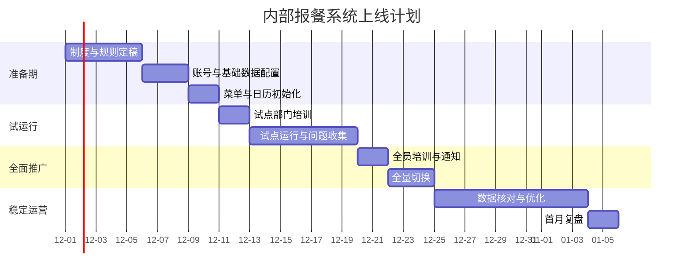

# 机关单位内部报餐系统 · 运营方案

> 适用对象：机关单位后勤管理部门、食堂、信息中心及各部门联络员。
> 系统形态：职工端 Web H5（手机浏览器）+ 管理后台（电脑浏览器）。
> 配套文档：《内部报餐系统设计文档》。

---

## 一、方案概述

### 1. 运营目标

以「减少浪费、提升效率、数据可查、职工满意」为核心，用线上报餐替代口头/微信群报餐，实现：

- 食堂按实际报餐量备餐，降低剩餐率与临时加餐压力；
- 职工随时查看菜单、截止时间和个人记录，减少漏报、错报；
- 管理部门按部门、日期、餐次掌握就餐人数与自费金额；
- 全流程留痕，逾期、代报、取消有据可查。

### 2. 运营原则

| 原则 | 说明 |
|------|------|
| 减负优先 | 职工操作不超过 3 步，管理端不新增重复台账 |
| 制度先行 | 报餐截止、取消、逾期、自费规则先发文再上线 |
| 试点先行 | 先 1–2 个部门试运行，稳定后全面推广 |
| 数据说话 | 以线上报餐率、浪费率、异常率为核心指标 |
| 安全合规 | 最小权限、操作留痕、数据不外传、定期备份 |

### 3. 运营范围

- 覆盖人群：本单位在编职工、借调人员、长期外包人员（按需开通账号）。
- 覆盖餐次：早餐、午餐、晚餐（可按实际供餐调整）。
- 覆盖场景：日常报餐、加班餐、会议餐另行线下申请，不纳入本系统首期。

---

## 二、运营目标与指标体系

### 1. 北极星指标

**线上报餐率 = 线上报餐人次 ÷ 实际就餐人次 × 100%**

### 2. 分阶段目标（建议值，可按单位实际调整）

| 指标 | 上线首月 | 第 3 个月 | 第 6 个月 |
|------|:-------:|:--------:|:--------:|
| 账号开通率 | ≥ 95% | 100% | 100% |
| 线上报餐率 | ≥ 70% | ≥ 85% | ≥ 92% |
| 准点报餐率（截止前） | ≥ 90% | ≥ 95% | ≥ 97% |
| 逾期申请占比 | ≤ 8% | ≤ 4% | ≤ 2% |
| 报餐后爽约率 | ≤ 5% | ≤ 3% | ≤ 2% |
| 异常申请 2 小时内处理率 | ≥ 90% | ≥ 95% | ≥ 98% |
| 职工满意度 | ≥ 80 分 | ≥ 85 分 | ≥ 90 分 |
| 自费金额对账准确率 | 100% | 100% | 100% |

### 3. 指标口径

| 指标 | 口径 |
|------|------|
| 线上报餐人次 | 状态为「已报餐」「管理员代报」的记录数 |
| 实际就餐人次 | 食堂出餐核对后的实际取餐人次 |
| 准点报餐率 | 截止前提交且未逾期的报餐数 ÷ 总报餐数 |
| 爽约率 | 已报餐但未取餐人次 ÷ 已报餐人次 |
| 异常处理时长 | 审核时间 − 申请提交时间 |
| 自费金额 | 系统按「餐标合计 − 免费额度 × 份数」计算的自费合计 |

> 数据来源：管理后台「数据看板 / 部门统计 / 报餐明细」，通过 CSV 导出留档。

---

## 三、组织与职责

### 1. 运营组织架构

```
单位分管领导（组长）
├── 后勤管理部门（运营牵头）
│   ├── 食堂管理员（系统 manager）
│   └── 食堂班组（备餐、出餐核对）
├── 信息中心（系统 admin / 技术保障）
├── 各部门联络员（每部门 1 名）
└── 全体职工（使用方）
```

### 2. 职责分工（RACI）

| 工作事项 | 分管领导 | 后勤部门 | 食堂管理员 | 信息中心 | 部门联络员 | 职工 |
|----------|:--------:|:--------:|:----------:|:--------:|:----------:|:----:|
| 制度发文与考核 | A | R | C | I | I | I |
| 菜单与规则配置 | I | A | R | C | I | I |
| 账号开通与权限 | I | C | C | R/A | I | I |
| 日常报餐提醒 | I | A | R | I | R | I |
| 截止后汇总下单 | I | A | R | I | I | I |
| 异常申请审核 | I | A | R | I | C | I |
| 自费对账与收取 | A | R | C | I | I | I |
| 系统运维与备份 | I | C | I | R/A | I | I |
| 数据统计与月报 | I | A | R | C | I | I |
| 培训与答疑 | I | A | C | C | R | I |

> R=负责执行，A=最终负责，C=被咨询，I=被通知。

### 3. 关键角色配置

| 角色 | 系统角色 | 人数建议 | 主要权限 |
|------|----------|:--------:|----------|
| 系统管理员 | admin | 1–2 人 | 全部功能、操作日志、账号与规则 |
| 食堂管理员 | manager | 1–2 人 | 菜单、规则、异常审核、代报、统计导出 |
| 部门负责人 | leader | 每部门 1 人 | 仅本部门看板、明细、统计（只读） |
| 部门联络员 | staff | 每部门 1 人 | 职工权限 + 线下答疑，不额外授权 |
| 普通职工 | staff | 全员 | 本人报餐、取消、逾期申请、个人记录 |

---

## 四、上线实施计划

### 1. 总体节奏（建议 5 周）



> 日期为示例，实际以单位发文与食堂排期为准。

### 2. 分阶段任务与交付物

| 阶段 | 关键任务 | 交付物 | 责任方 |
|------|----------|--------|--------|
| 准备期 | 明确截止时间、取消规则、逾期策略、免费额度；导入部门与人员；配置管理员账号；初始化菜单与工作日历 | 管理制度、账号清单、菜单与规则配置 | 后勤 + 信息中心 |
| 试运行 | 选 1–2 个部门试点；培训联络员；收集问题；每日核对报餐与实际出餐 | 试点问题清单、优化项 | 后勤 + 试点部门 |
| 全面推广 | 全员培训；发布上线通知；食堂现场引导；启用逾期审核 | 培训记录、上线通知、FAQ | 后勤 + 各部门 |
| 稳定运营 | 日报/周报；自费对账；异常复盘；规则微调 | 周报、月报、对账台账 | 后勤 + 食堂 |

### 3. 上线前置检查清单

- [ ] 报餐截止时间与供餐时间已在系统配置并与食堂排班一致
- [ ] 全局规则与部门覆盖规则已确认（提前天数、份数上限、取消权限、免费额度）
- [ ] 工作日历覆盖未来 1 个月，节假日与调休已标注
- [ ] 未来 7 天菜单已录入并发布
- [ ] 全员账号已导入，工号唯一，离职/停用人员已禁用
- [ ] 管理员、负责人权限已验证
- [ ] 系统可正常登录、报餐、取消、逾期申请与审核
- [ ] 数据备份策略与责任人已明确
- [ ] 上线通知、操作手册、FAQ 已准备

---

## 五、日常运营机制

### 1. 运营日历

| 周期 | 时间 | 事项 | 责任人 |
|------|------|------|--------|
| 每日 | 前一工作日 16:00 前 | 录入并发布次日菜单 | 食堂管理员 |
| 每日 | 截止前 30 分钟 | 系统/群内提醒未报餐人员 | 部门联络员 |
| 每日 | 截止后 30 分钟内 | 按餐次导出报餐汇总，通知食堂备餐 | 食堂管理员 |
| 每日 | 开餐后 | 出餐核对，登记实际取餐与爽约 | 食堂班组 |
| 每日 | 当日 18:00 前 | 处理待审异常申请 | 食堂管理员 |
| 每周 | 周一 | 上周数据周报（报餐率、逾期率、爽约率、自费） | 后勤部门 |
| 每周 | 周五 | 下周菜单预排与公示 | 食堂管理员 |
| 每月 | 次月 3 个工作日内 | 月度统计、自费对账、满意度调查 | 后勤 + 财务 |
| 每季度 | 季末 | 规则评审、需求池评审、版本优化 | 运营小组 |

### 2. 每日标准作业流程（SOP）

**食堂管理员**

1. 检查次日菜单是否已发布、菜品价格与免费/自费标识是否正确。
2. 截止后导出各餐次明细与汇总，按部门核对人数与份数。
3. 将汇总数据交食堂班组备餐，异常数量（突增/突减）及时沟通。
4. 审核逾期申请：核实原因，通过或驳回并填写意见。
5. 处理代报请求：仅限经口头/书面确认的职工，代报后告知本人。
6. 登记实际取餐情况，标记爽约，用于次日提醒与月度分析。

**部门联络员**

1. 接收并转发每日报餐提醒。
2. 协助本部门新同事完成首次登录与报餐。
3. 收集本部门意见，汇总至后勤部门。

**信息中心**

1. 每日检查系统健康状态与登录异常。
2. 每周执行数据备份并验证可恢复。
3. 处理账号开通、停用、密码重置与权限调整。

### 3. 服务响应时限（SLA）

| 事项 | 响应时限 | 处理时限 |
|------|----------|----------|
| 登录/报餐故障 | 15 分钟 | 2 小时 |
| 菜单/规则配置错误 | 30 分钟 | 当日截止前 |
| 逾期申请审核 | 2 小时 | 当日开餐前 |
| 账号与权限申请 | 1 个工作日 | 2 个工作日 |
| 数据导出/对账支持 | 1 个工作日 | 3 个工作日 |

---

## 六、制度与规则落地

### 1. 报餐制度要点

| 规则 | 建议设置 | 系统对应能力 |
|------|----------|--------------|
| 报餐截止 | 早餐 06:30、午餐 09:30、晚餐 15:00（可按食堂实际调整） | 餐次截止时间 + 日期偏移 |
| 提前报餐 | 最多提前 7 天 | 规则 `advanceDays` |
| 单餐份数 | 默认 1 份，最多 2 份 | 规则 `maxQtyPerMeal` |
| 取消 | 截止前可自助取消；截止后需申请 | 规则 `allowCancel` + 异常申请 |
| 逾期 | 需提交申请，管理员审核 | 逾期策略 + 审核流程 |
| 免费额度 | 午餐 20 元/份（部门可覆盖） | 规则 `freeQuota` |
| 爽约 | 当月累计 3 次，部门内提醒；5 次以上通报 | 出餐核对 + 月度统计 |

### 2. 自费管理

1. **额度公示**：上线前公示各餐次免费额度与菜品单价，职工报餐时实时可见「餐标合计 / 需自费」。
2. **收取方式**：建议按月汇总，由食堂出具月度自费台账，职工扫码或窗口补缴；单位另有规定的从其规定。
3. **对账流程**：每月 3 个工作日内，食堂管理员导出汇总 CSV → 财务复核 → 公示 3 天 → 收取并销账。
4. **争议处理**：以系统报餐记录与操作日志为准；确因系统或人工原因多收，凭记录退还并留痕。

### 3. 代报与特殊情形

- 代报仅限：不会使用手机的老同志、会议/加班统一报餐、系统故障期间。
- 代报必须由 manager/admin 操作，系统记录操作人与时间。
- 停餐、停电、疫情等特殊情况，由后勤部门统一下发通知并调整日历/菜单。

---

## 七、用户运营与培训

### 1. 分角色培训

| 对象 | 培训内容 | 形式 | 时长 |
|------|----------|------|------|
| 全体职工 | 登录、查看菜单、报餐/修改/取消、逾期申请、查看记录 | 3 分钟短视频 + 图文手册 | 10 分钟 |
| 部门联络员 | 职工操作 + 常见问题 + 提醒话术 | 集中培训 | 30 分钟 |
| 食堂管理员 | 菜单维护、规则配置、异常审核、代报、统计导出 | 实操演练 | 60 分钟 |
| 信息中心 | 账号权限、备份恢复、故障排查 | 技术交底 | 60 分钟 |

### 2. 运营物料清单

- 操作手册（职工版 / 管理员版，PDF 或在线图文）
- 常见问题 FAQ（不少于 15 条）
- 上线通知模板、每日提醒模板、月度通报模板
- 食堂窗口/餐桌二维码（指向 `/app`）
- 培训签到表与满意度问卷

### 3. 推广激活动作

| 时间 | 动作 |
|------|------|
| 上线前 3 天 | 发布上线通知，公布规则与免费额度 |
| 上线首日 | 食堂现场设引导岗，协助首次报餐 |
| 首周 | 每日群内提醒，公布各部门报餐率 |
| 第 2 周 | 通报未激活人员，联络员一对一协助 |
| 首月 | 发布首月运营简报，表扬高参与部门 |

### 4. 通知模板

**上线通知（示例）**

> 各位同事：自 X 月 X 日起，单位食堂报餐统一通过「内部报餐系统」办理。请使用工号登录，于各餐次截止时间前完成报餐。午餐截止 09:30，晚餐截止 15:00。逾期请提交申请，由食堂管理员审核。操作手册见附件。

**每日提醒（示例）**

> 提醒：今日午餐报餐将于 09:30 截止，尚未报餐的同事请及时提交；需取消的请在截止前操作。

---

## 八、数据运营

### 1. 报表体系

| 报表 | 周期 | 内容 | 使用人 |
|------|------|------|--------|
| 每日报餐汇总 | 每日 | 各餐次、各部门人数与份数 | 食堂、后勤 |
| 报餐明细 | 按需 | 人员、菜品、自费、状态 | 食堂、财务 |
| 周报 | 每周 | 报餐率、逾期率、爽约率、异常处理 | 后勤、分管领导 |
| 月报 | 每月 | 趋势、部门对比、自费合计、满意度 | 分管领导 |
| 季度复盘 | 每季 | 目标达成、问题清单、优化计划 | 运营小组 |

### 2. 异常预警规则

| 预警项 | 阈值 | 动作 |
|--------|------|------|
| 单餐报餐量突增/突减 | 较近 4 周均值 ±30% | 食堂确认备餐，排查是否误报 |
| 逾期申请占比 | 单周 > 8% | 检查截止时间是否合理、提醒是否到位 |
| 爽约率 | 单周 > 5% | 部门提醒，必要时调整规则 |
| 待审异常积压 | 超过 10 条或超 2 小时 | 通知管理员处理 |
| 登录失败集中 | 同一账号连续 5 次 | 核实是否为密码遗忘或异常尝试 |

### 3. 数据安全与留痕

- 仅 admin 可查看操作日志；manager 仅查看业务数据；leader 仅本部门。
- 导出文件含姓名与部门，按「谁导出、谁负责」管理，禁止外传。
- 每月备份数据库文件，至少保留 6 个月；重要变更前额外备份。
- 离职人员及时停用账号，历史记录保留以备审计。

---

## 九、风险与应急预案

| 风险 | 影响 | 预防措施 | 应急处理 |
|------|------|----------|----------|
| 系统不可用 | 职工无法报餐 | 每日健康检查、稳定网络与电源 | 启用纸质/群内临时报餐，恢复后由管理员补录并留痕 |
| 数据丢失 | 报餐与对账数据缺失 | 每周备份 + 变更前备份 | 从最近备份恢复，核对当日纸质记录 |
| 账号被盗用 | 他人代报/恶意取消 | 强密码、离职即停用、异常登录关注 | 立即停用账号、重置密码、核查日志 |
| 隐私泄露 | 姓名/部门/报餐信息公开 | 最小权限、导出审批、禁止外传 | 停止扩散、追溯导出记录、按制度处理 |
| 食堂供应波动 | 备餐不足或过剩 | 按截止汇总备餐、设置预警阈值 | 启动应急加餐/调整菜单并通知 |
| 职工不会用 | 报餐率低 | 培训、二维码、联络员帮扶 | 现场引导、一对一辅导、保留代报通道 |
| 规则争议 | 职工不认可自费/逾期处理 | 制度先发文、额度与单价公示 | 以系统记录与日志为依据复核，必要时调整规则 |

### 系统故障降级流程

1. 信息中心 15 分钟内确认故障范围并通知后勤。
2. 后勤通过部门联络员群发布临时报餐方式与截止时间。
3. 食堂按临时登记备餐。
4. 系统恢复后，管理员在 24 小时内完成补录，日志注明「故障补录」。
5. 3 个工作日内出具故障说明与改进措施。

---

## 十、考核与持续改进

### 1. 部门考核建议

| 指标 | 权重建议 | 说明 |
|------|:--------:|------|
| 线上报餐率 | 40% | 反映推广与使用程度 |
| 准点报餐率 | 25% | 反映规则执行情况 |
| 爽约率（反向） | 20% | 反映报餐严肃性 |
| 异常申请处理配合度 | 15% | 反映协同效率 |

> 考核结果建议以通报、表扬为主，避免简单处罚；具体按单位内部制度执行。

### 2. 需求与迭代机制

- 需求来源：职工反馈、联络员汇总、食堂痛点、数据异常。
- 评审节奏：每月收集、每季度评审，形成需求池并排序。
- 优先级：合规与数据安全 > 影响报餐主流程 > 效率提升 > 体验优化。
- 后续可评估方向：企业微信/政务微信免登、出餐扫码核销、原生 Excel 报表、多食堂/多楼层支持、消息提醒推送。

### 3. 首月复盘提纲

1. 目标达成情况（对照第二节指标）。
2. 报餐率最低的部门及原因。
3. 逾期与爽约TOP 场景。
4. 自费对账差异及原因。
5. 系统问题与处理时长。
6. 下月三项重点改进措施与责任人。

---

## 附：角色操作速查

| 场景 | 操作路径 |
|------|----------|
| 职工报餐 | 登录 → 选择日期 → 选择餐次 → 勾选菜品 → 确认 |
| 职工取消 | 登录 → 对应餐次 → 取消报餐（截止前） |
| 职工逾期申请 | 登录 → 对应餐次 → 申请逾期 → 填写原因 |
| 管理员发布菜单 | 管理后台 → 菜单维护 → 选择日期/餐次 → 编辑 → 保存 → 发布 |
| 管理员审核异常 | 管理后台 → 异常处理 → 通过/驳回 → 填写意见 |
| 管理员代报 | 管理后台 → 报餐明细 → 代报 → 选择职工与菜品 |
| 管理员导出 | 管理后台 → 报餐明细/部门统计 → 导出 CSV |
| 管理员配置规则 | 管理后台 → 报餐规则 → 全局/部门 → 保存 |
| 管理员维护日历 | 管理后台 → 工作日历 → 选择日期 → 设置是否供餐 |
| 系统管理员查日志 | 管理后台 → 操作日志 |
